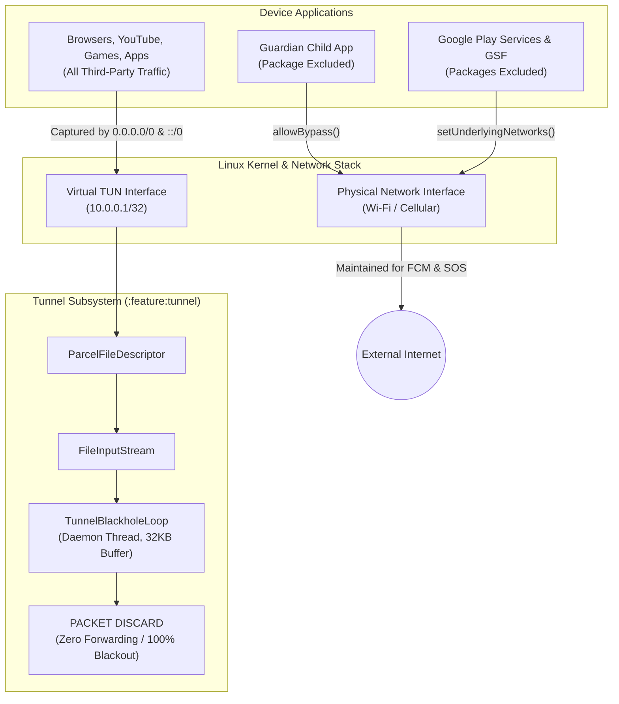
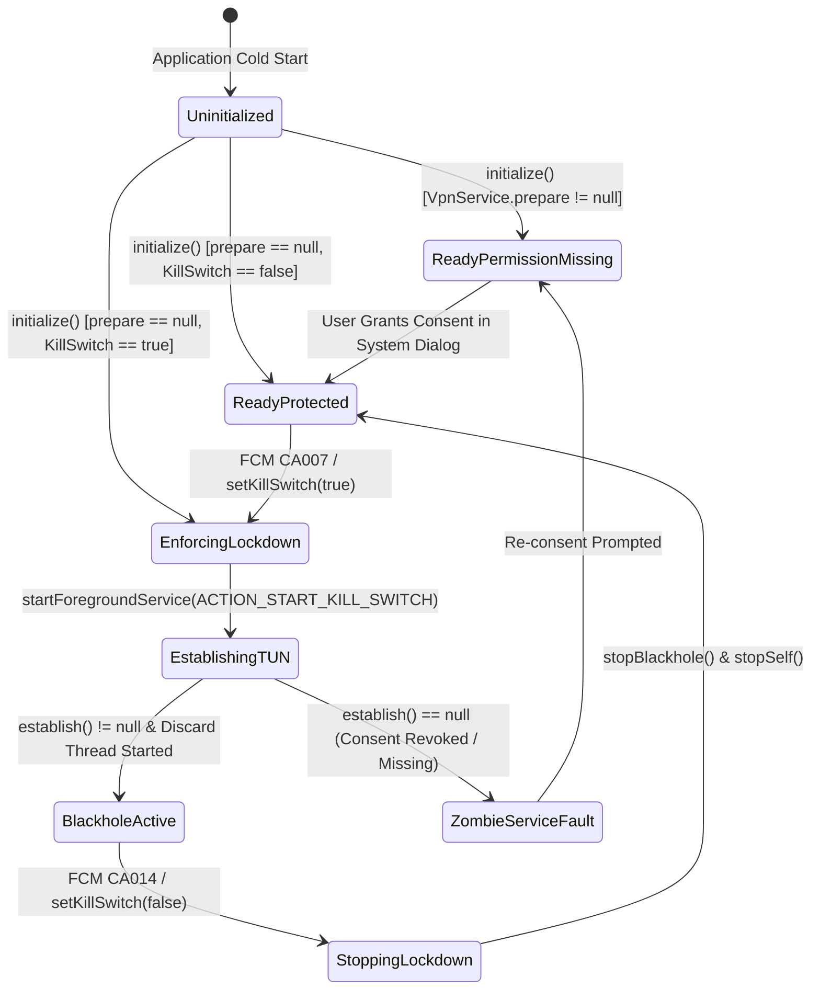
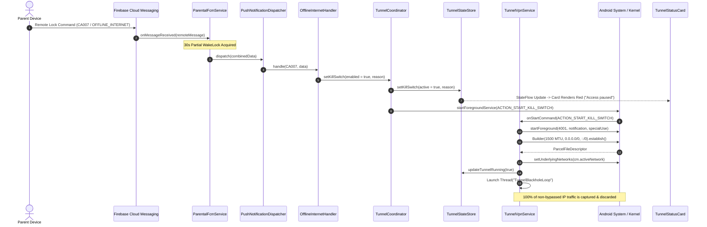
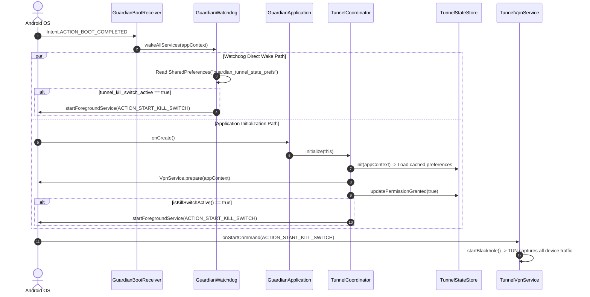
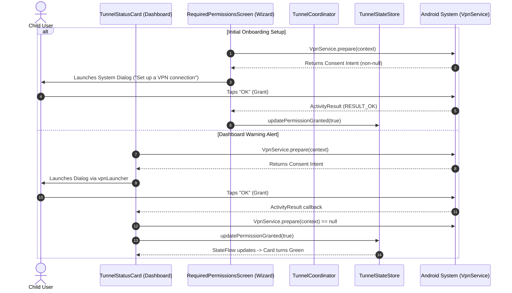

# Tunnel & Kill-Switch Module Audit
**Subsystem**: `:feature:tunnel` / Internet Lockdown & Kill-Switch Engine  
**Host Application**: Guardian Child (`com.guardian.child`)  
**Target Platform**: Android 8.0+ (API 26–37)  
**Process Topology**: Main Process (`com.guardian.child` [Default UI & VPN]) & `:protection` [Supervision / Watchdog IPC]  
**Target Scope**: 100% Device Traffic (IPv4 `0.0.0.0/0` & IPv6 `::/0`) | Bypassed: Guardian App, GMS, GSF

---

## 1. Coverage Checklist

| Subsystem / Area | Inspected Files / Components |
|---|---|
| **Module Wiring & Registrations** | `settings.gradle.kts`, `app/build.gradle.kts`, `feature/tunnel/build.gradle.kts`, `feature/tunnel/.../AndroidManifest.xml` |
| **Application & Service Init** | `GuardianApplication.kt`, `MainActivity.kt`, `TunnelCoordinator.kt` |
| **Driver & Network Core** | `TunnelVpnService.kt`, `VpnService.Builder`, `TunnelBlackholeLoop` (Daemon Thread) |
| **State & Persistence Layer** | `TunnelStateStore.kt`, `TunnelState.kt`, `guardian_tunnel_state_prefs` |
| **Logging & Diagnostics** | `TunnelLogger.kt` (`GuardianTunnel:<TAG>`) |
| **Child Dashboard UI** | `TunnelStatusCard.kt`, `DashboardScreen.kt` |
| **Onboarding & Permission Wizard** | `RequiredPermissionsScreen.kt`, `VpnService.prepare` |
| **Cold-Boot & Watchdog Recovery** | `GuardianBootReceiver.kt`, `GuardianWatchdog.kt` |
| **Remote Sync & FCM Routing** | `ParentalFcmService.kt`, `GuardianNotificationListenerService.kt`, `PushMessageReceiverHub.kt`, `PushNotificationDispatcher.kt`, `PushNotificationCategory.kt`, `OfflineInternetHandler.kt` |
| **Unit Test Suites** | `TunnelStateTest.kt` |

---

## 2. Functional Roadmap and Data Flow

### 2.1. Flow A: Internet Lockdown & Kill-Switch Lifecycle

```
[A] Trigger Received (FCM CA007 / Cold Boot / Local Supervision)
           │
           ▼
[B] Persist Target State (TunnelStateStore -> SharedPreferences)
           │
           ▼
[C] Evaluate VPN Consent (VpnService.prepare)
           │
     ┌─────┴──────────────┐
     ▼                    ▼
[D] CONSENT READY     [E] CONSENT MISSING
     │                    │
     ▼                    └─► Abort & Prompt User via UI Launcher
[F] Establish TUN Blackhole (TunnelVpnService)
     │
     ├─► 1. Start Foreground Service (specialUse FGS, Notif ID 4001)
     ├─► 2. Exclude Critical Packages (Guardian App, Google Play Services, GSF)
     ├─► 3. Bind Physical Network (cm.activeNetwork -> setUnderlyingNetworks)
     ├─► 4. Launch Discard Thread (Zero-forward loop on 32KB buffer)
     └─► 5. Emit UI State (Dashboard card updates to "Access paused by parent")
```

---

#### [A] Trigger Ingestion & Routing (Refer to **Diagram 3 — Remote FCM Lockdown Sequence**)

1. **Remote Parent Push Commands**:
   - `CA007` (`OFFLINE_INTERNET`): Enables kill-switch lockdown.
   - `CA014` (`UNBLOCK_INTERNET`): Disables kill-switch and restores internet.
2. **Dual Push Delivery Paths**:
   - **Direct Background FCM**: Caught by `ParentalFcmService.onMessageReceived()`. Acquires a 30-second `PARTIAL_WAKE_LOCK`, verifies silent category, suppresses system notifications, and routes payload to `PushMessageReceiverHub`.
   - **Status-Bar Notification Fallback**: If the app process was terminated and OS posts to tray, `GuardianNotificationListenerService.onNotificationPosted()` catches the notification, cancels the tray banner, and dispatches to `PushMessageReceiverHub`.
3. **Dispatch to Handler**:
   - `PushNotificationDispatcher` resolves category and invokes `OfflineInternetHandler.handle()`.
   - Extracts reason text (`"Internet access paused by parent"`) and calls `TunnelCoordinator.setKillSwitch(enabled = true/false)`.

> [!IMPORTANT]
> Both `ParentalFcmService` and `GuardianNotificationListenerService` explicitly treat `OFFLINE_INTERNET` and `UNBLOCK_INTERNET` as silent background commands. No toasts or intrusive notifications are shown.

---

#### [B] State Persistence & Evaluation

1. `TunnelCoordinator.setKillSwitch(enabled, context, reason)` is the central command entry point.
2. Persists values into `SharedPreferences` (`guardian_tunnel_state_prefs`):
   - `KEY_KILL_SWITCH` (`"tunnel_kill_switch_active"`) = `true/false`
   - `KEY_ACTIVE_REASON` (`"tunnel_active_reason"`) = reason string
   - `KEY_TIMESTAMP` (`"tunnel_last_timestamp"`) = `System.currentTimeMillis()`
3. Concurrently updates in-memory `_state.value` (`MutableStateFlow<TunnelState>`) for immediate UI reaction.
4. Persisted state survives process death and device reboots.

---

#### [C] Permission & Consent Verification (Refer to **Diagram 5 — VPN Consent Negotiation**)

1. Evaluates `VpnService.prepare(context)`:
   - Returns `null`: Consent is already granted. Proceed to service start.
   - Returns `Intent`: First-time setup required or permission was revoked.
2. If consent is missing:
   - In UI contexts (`TunnelStatusCard`, `RequiredPermissionsScreen`), launches the system VPN consent dialog (`"Guardian wants to set up a VPN connection"`).
   - If triggered remotely via FCM while consent is missing, `builder.establish()` fails and logs an error.

---

#### [F] TUN Allocation & Blackhole Mechanics (Refer to **Diagram 1 — End-to-End Data Flow**)

1. **Foreground Service Promotion**:
   - `TunnelCoordinator` calls `ContextCompat.startForegroundService()` with action `ACTION_START_KILL_SWITCH`.
   - In `onStartCommand()`, promotes to Foreground Service with `NOTIFICATION_ID = 4001` on channel `guardian_tunnel_killswitch_channel` (`IMPORTANCE_LOW`).
   - Android 14+ (API 34): Declares `FOREGROUND_SERVICE_TYPE_SPECIAL_USE`.
2. **Virtual TUN Interface Configuration**:
   - `setSession("Guardian Kill-Switch")`
   - `setMtu(1500)`: Standard Ethernet MTU.
   - `addAddress("10.0.0.1", 32)`: Local virtual endpoint.
   - `addRoute("0.0.0.0", 0)`: Captures 100% of IPv4 destination traffic.
   - `addRoute("::", 0)`: Captures 100% of IPv6 destination traffic (closes IPv6 leaks).
   - `addDnsServer("8.8.8.8")`, `addDnsServer("1.1.1.1")`
   - `allowBypass()`: Permits excluded applications to route traffic directly.
3. **Critical Package Exclusions**:
   - Loops over bypass list: `packageName` (Guardian Child), `com.google.android.gms` (Google Play Services), `com.google.android.gsf` (Google Services Framework).
   - Calls `builder.addDisallowedApplication(pkg)` in a try-catch per package.
4. **Physical Network Binding**:
   - Queries `ConnectivityManager.activeNetwork`.
   - Calls `setUnderlyingNetworks(arrayOf(activeNet))` to ensure bypassed Google Play Services and FCM retain access to physical Wi-Fi/Cellular.
5. **Zero-Forward Discard Loop**:
   - `builder.establish()` returns `ParcelFileDescriptor`.
   - Spawns daemon thread `TunnelBlackholeLoop` (`isDaemon = true`).
   - Allocates single reusable buffer: `val buffer = ByteArray(32767)`.
   - Executes `while (isRunning && !Thread.interrupted()) { val bytesRead = inputStream.read(buffer) ... }`.
   - **Zero packet forwarding**: All bytes are dropped. No packet parsing, no socket forwarding, and no GC memory churn.

> [!IMPORTANT]
> Excluding Google Play Services (`gms`) and GSF is critical. FCM maintains a persistent TCP connection on ports 5228–5230. Capturing GMS into the blackhole would sever FCM, permanently preventing the parent from unblocking the device remotely.

---

#### [G] Release / Restore Internet Flow

1. Parent sends CA014 (`UNBLOCK_INTERNET`) or coordinator triggers `setKillSwitch(false)`.
2. Updates `TunnelStateStore` with `isKillSwitchActive = false`.
3. Issues `Intent(context, TunnelVpnService::class.java)` with action `ACTION_STOP_KILL_SWITCH`.
4. `TunnelVpnService.stopBlackhole()`:
   - Sets `isRunning = false` and `isServiceRunning = false`.
   - Emits `TunnelStateStore.updateTunnelRunning(false)`.
   - Calls `blackholeThread?.interrupt()`.
   - Closes `tunInterface?.close()` (`ParcelFileDescriptor`), which unbinds the Linux TUN interface.
5. Calls `stopForeground(STOP_FOREGROUND_REMOVE)` and `stopSelf()`.
6. Linux kernel routing table reverts: all apps resume normal communication over Wi-Fi/Cellular.

---

### 2.2. Flow B: Cold-Boot Restoration Lifecycle (Refer to **Diagram 4**)

1. Child powers on device or phone reboots after battery drain.
2. Android OS broadcasts `Intent.ACTION_BOOT_COMPLETED` or `LOCKED_BOOT_COMPLETED`.
3. **Dual Boot Restoration Paths**:
   - **Application Process Path**: `GuardianApplication.onCreate()` executes on process start and calls `TunnelCoordinator.initialize(this)`. Reads `guardian_tunnel_state_prefs`. If `isKillSwitchActive == true`, immediately issues `startKillSwitchService()`.
   - **Watchdog Path**: `GuardianBootReceiver` catches boot broadcast and triggers `GuardianWatchdog.wakeAllServices()`. Reads `guardian_tunnel_state_prefs` and dispatches explicit intent `com.guardian.child.tunnel.START_KILL_SWITCH`.
4. Device is locked down before the child can open any browser or application.

---

### 2.3. Flow C: VPN Consent Preparation & Onboarding Lifecycle (Refer to **Diagram 5**)

1. During initial setup, `RequiredPermissionsScreen` includes `ProtectionPermission.Vpn`.
2. Calls `VpnService.prepare(context)`:
   - If consent is required, launches system dialog via `rememberLauncherForActivityResult`.
   - When parent taps "OK", callback fires with `RESULT_OK`.
   - Calls `TunnelStateStore.updatePermissionGranted(true)`.

---

## 3. Internal Implementation Reference

### 3.1 Additional Notes

- **Zero-Allocation Blackhole Loop:** `TunnelVpnService.kt` allocates `val buffer = ByteArray(32767)` once prior to entering the `while` loop. Zero garbage collection pressure during sustained packet discard.
- **Dual Default Routing (`0.0.0.0/0` + `::/0`):** Dual IPv4 and IPv6 routes capture all outbound traffic. Prevents IPv6 leak vulnerabilities common in IPv4-only VPN implementations.
- **Low-Importance Notification Channel:** `guardian_tunnel_killswitch_channel` is configured with `NotificationManager.IMPORTANCE_LOW` and `setShowBadge(false)` to minimize UI disruption while complying with Android foreground service requirements.

---

### 3.2 Design Rationale and Questions

#### 1. Why are Google Play Services (`gms`) and Services Framework (`gsf`) bypassed?
FCM maintains a persistent TCP socket to Google infrastructure on ports 5228–5230. If `gms` or `gsf` are routed into the blackhole TUN interface, all Google push channels drop. The child's device would become unreachable, preventing parents from sending `CA014 UNBLOCK_INTERNET` or emergency commands.

#### 2. Why is `allowBypass()` explicitly invoked?
In Android VPN architecture, capturing default routes (`0.0.0.0/0`) can cause routing conflicts for excluded apps if bypass routing is not enabled at the builder level. `allowBypass()` ensures excluded packages are permitted by the OS routing table to transmit directly onto underlying physical interfaces.

#### 3. Why bind physical underlying networks (`setUnderlyingNetworks`)?
In Android 9.0+ (Pie), if a VPN captures all traffic without declaring underlying networks, the OS considers the VPN the sole network. Consequently, bypassed apps attempt to send traffic to an interface Android treats as inactive. Passing `arrayOf(cm.activeNetwork)` informs the OS that underlying physical connectivity exists for excluded apps.

#### 4. Why is MTU set to 1500?
Packets are dropped locally in the kernel bit bucket and never encapsulated into outer tunnel protocols. No MTU deduction is needed for outer headers; 1500 matches standard Ethernet.

---

### 3.3 Logical Concerns

* **Direct SharedPreferences Bypass on Boot Recovery**: In `GuardianWatchdog.kt:196-206`, `executeWakeServices()` reads `"guardian_tunnel_state_prefs"` via raw hardcoded strings and directly fires `START_KILL_SWITCH` without calling `TunnelCoordinator.initialize()`, leaving coordinator in-memory state uninitialized.
* **Redundant Duplicate Initialization**: In `GuardianApplication.kt:25` and `MainActivity.kt:50`, `TunnelCoordinator.initialize()` is called twice during normal app launch.
* **Thread-Unsafe Singleton Initialization**: In `TunnelStateStore.kt:24-26`, `init()` uses an unsynchronized, non-volatile `if (prefs == null)` check, susceptible to race conditions under concurrent multi-thread invocation.
* **Cross-Process StateFlow Desynchronization**: In `TunnelStateStore.kt:20-21`, state is stored in an in-memory JVM `MutableStateFlow`. When `GuardianApplication` launches in `:protection`, state updates do not propagate across process boundaries to the main UI process.
* **Static Field Inter-Process Exposure**: In `TunnelCoordinator.kt:24`, `isRunning` reads `TunnelVpnService.isServiceRunning`. Because static fields are not shared across Android processes, queries from `:protection` return `false`.
* **Missing Dynamic Network Switch Handover**: In `TunnelVpnService.kt:120-128`, `setUnderlyingNetworks` is queried once on startup from `cm.activeNetwork`. No `ConnectivityManager.NetworkCallback` is registered; transitioning from Wi-Fi to Cellular during lockdown leaves bypassed FCM traffic stranded.
* **Failure to Clear Underlying Networks on Teardown**: In `TunnelVpnService.kt:159-174`, `stopBlackhole()` does not call `setUnderlyingNetworks(null)` when tearing down the tunnel.
* **Silent Zombie Service on Null Descriptor**: In `TunnelVpnService.kt:114-117`, if `builder.establish()` returns `null`, `startBlackhole()` logs and returns without calling `stopForeground()` or `stopSelf()`, leaving a permanent foreground service notification visible while no VPN is active.
* **State Store Inconsistency on Null TUN Allocation**: In `TunnelCoordinator.kt:60` and `TunnelVpnService.kt:116`, if `establish()` fails, `TunnelStateStore.isKillSwitchActive` remains `true` while `isTunnelRunning` remains `false`.
* **Missing Consent Pre-Check in `setKillSwitch`**: In `TunnelCoordinator.kt:56-67`, `setKillSwitch(enabled = true)` launches `TunnelVpnService` without checking `VpnService.prepare(context) == null`.
* **FileInputStream Resource Leak in Thread Loop**: In `TunnelVpnService.kt:136-146`, `blackholeThread` creates `FileInputStream(pfd.fileDescriptor)` but does not close it within a `finally` block or during service teardown.
* **Unpersisted Ephemeral State Flags**: In `TunnelStateStore.kt:58-64`, `isTunnelRunning` and `isVpnPermissionGranted` are not stored in SharedPreferences and reset to `false` on process recreation.
* **Model Naming Divergence from Master Architecture Spec**: In `TunnelState.kt:8`, the property is named `isTunnelRunning`, while `tunnel_master_engineering_spec.md:134` specifies `isTunnelActive`.

---

## 4. Performance Audit

### 4.1 Exhaustive Bottleneck Inventory

| ID | Component & File | Execution Context | Trigger / Frequency | Cost Driver & Likely Impact | Evidence Level | Estimated Complexity |
|---|---|---|---|---|---|---|
| **PERF-01** | `TunnelVpnService.kt:81-157`<br/>`tunnel/.../service/`<br/>`startBlackhole()` | Main (UI) Thread | Kill-Switch Enable (FCM, Boot, UI) | **Synchronous package resolution & Binder IPC**: iterates 3 packages and executes synchronous IPC to `IConnectivityManager` (`builder.establish()`) on the main looper. Can freeze UI or trigger ANR. | **Confirmed** | $\mathcal{O}(1)$ Binder IPC calls |
| **PERF-02** | `TunnelVpnService.kt:135-150`<br/>`tunnel/.../service/`<br/>`TunnelBlackholeLoop` | Background Daemon Thread | Continuous during lockdown | **Tight I/O loop under packet floods**: high-bandwidth background apps (video downloads, torrents, gaming) flood the virtual TUN. Thread spins continuously reading and discarding packets, driving high CPU and battery usage. | **Likely** | $\mathcal{O}(N)$ packets received |
| **PERF-03** | `TunnelVpnService.kt:147-150`<br/>`tunnel/.../service/`<br/>`Thread.start()` | Background Thread | Once per lockdown session | **Unadjusted Thread Priority**: daemon thread inherits default JVM priority (`NORM_PRIORITY = 5`) rather than Linux background priority (`THREAD_PRIORITY_BACKGROUND`), competing with UI rendering during packet floods. | **Confirmed** | Thread scheduling |
| **PERF-04** | `TunnelStatusCard.kt:69`<br/>`tunnel/.../ui/`<br/>`ON_RESUME Observer` | Main (UI) Thread | Every Activity `ON_RESUME` event | **Synchronous IPC on resume**: calls `VpnService.prepare(context)` (Binder IPC to `IConnectivityManager`) synchronously on every screen resume, adding 5–25ms latency. | **Likely** | 1 Binder IPC call per resume |
| **PERF-05** | `GuardianApplication.kt:25`<br/>`app/.../GuardianApplication.kt`<br/>`onCreate()` | Main (UI) Thread | Process cold start | **Cold-boot startup blocking**: synchronous disk read (`getSharedPreferences`) + Binder IPC (`VpnService.prepare`) executed during application startup before initial frame draw. | **Confirmed** | Disk I/O + 1 Binder IPC |
| **PERF-06** | `TunnelVpnService.kt:159-174`<br/>`tunnel/.../service/`<br/>`stopBlackhole()` | Main (UI) Thread | Kill-Switch Disable | **Synchronous kernel FD close**: closing Linux TUN `ParcelFileDescriptor` and interrupting thread on the main looper causes UI hitch during teardown. | **Confirmed** | Kernel descriptor close |
| **PERF-07** | `MainActivity.kt:50`<br/>`app/.../MainActivity.kt`<br/>`onCreate()` | Main (UI) Thread | Activity creation | **Redundant Coordinator Initialization**: calls `TunnelCoordinator.initialize()` immediately after `GuardianApplication.onCreate()` already completed it. | **Confirmed** | Redundant disk + IPC work |
| **PERF-08** | `TunnelVpnService.kt:137`<br/>`tunnel/.../service/`<br/>`buffer allocation` | Background Thread | Once per session | **Zero Allocation Discard Loop**: pre-allocated 32KB buffer reused for all reads. Eliminates heap allocations and GC churn in the discard path. | **Confirmed (Positive)** | $\mathcal{O}(1)$ single allocation |

---

## 5. Diagrams

### Diagram 1 — End-to-End Data Flow



### Diagram 2 — Tunnel & Kill-Switch State Machine



### Diagram 3 — Remote FCM Lockdown Sequence



### Diagram 4 — Cold-Boot Restoration & Watchdog Sequence



### Diagram 5 — System VPN Consent Negotiation Sequence


