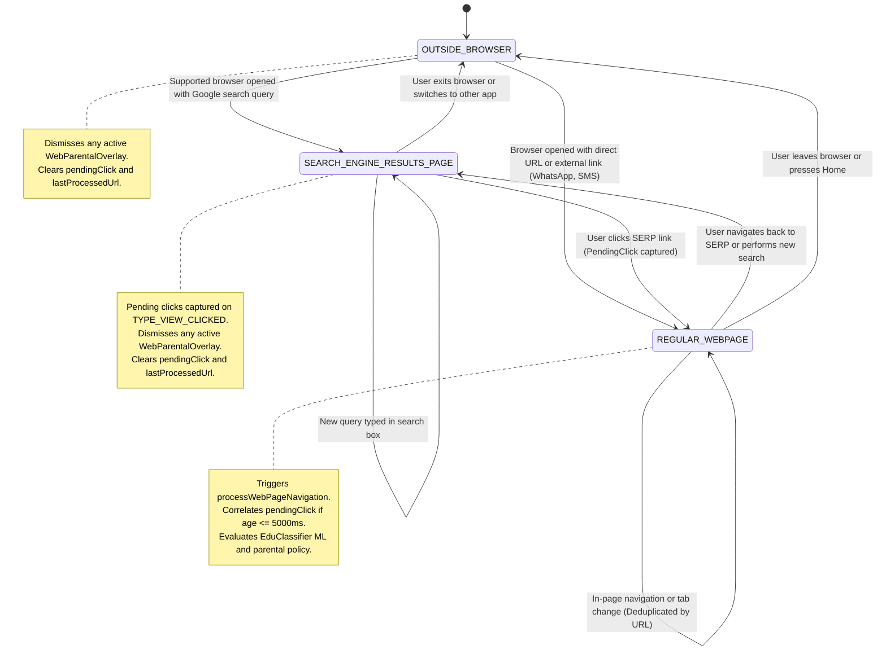
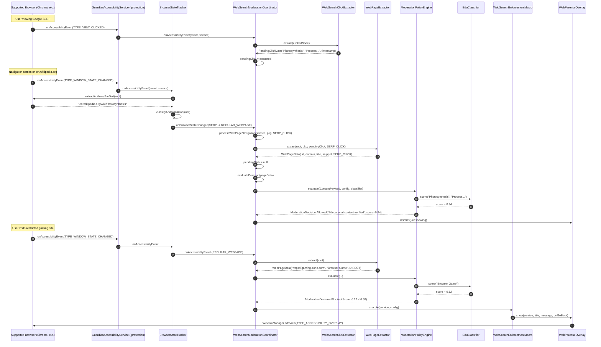
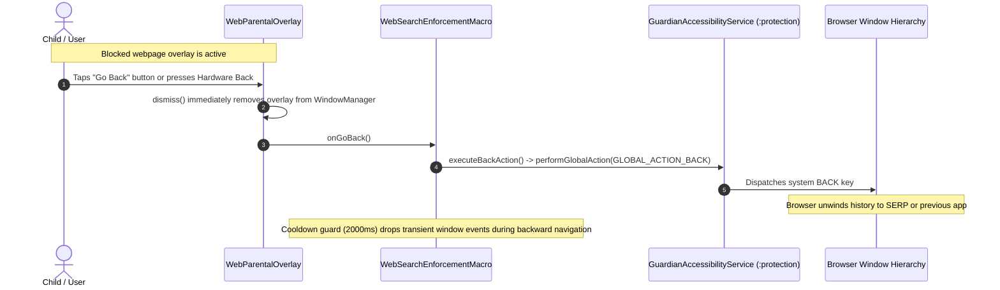
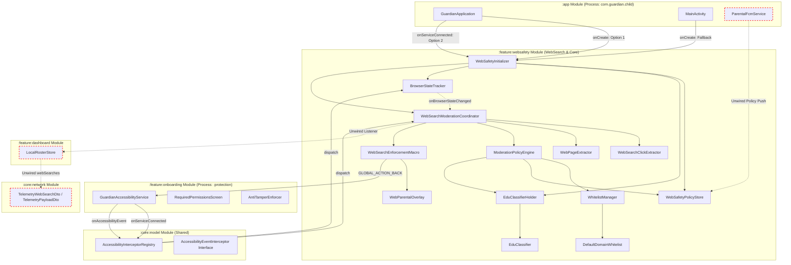

# WebSearch Module Audit
**Subsystem**: `:feature:websafety` / WebSearch Moderation Engine  
**Host Application**: Guardian Child (`com.guardian.child`)  
**Target Platform**: Android 8.0+ (API 26–37)  
**Process Topology**: Dual-Process (`com.guardian.child` [Default UI] & `:protection` [Accessibility / Supervision])  
**Target Browsers**: Verified (Chrome, Google Search App) | Unverified (Samsung Browser, Edge, Brave, Firefox,) 

---

## 1. Coverage Checklist

| Subsystem / Area | Inspected Files / Components |
|---|---|
| **Module Wiring & Registrations** | `settings.gradle.kts`, `app/build.gradle.kts`, `feature/websafety/build.gradle.kts`, `app/.../AndroidManifest.xml`, `feature/onboarding/.../AndroidManifest.xml` |
| **Application & Service Init** | `GuardianApplication.kt`, `MainActivity.kt`, `GuardianPermissionServices.kt`, `WebSafetyInitializer.kt`, `AccessibilityEventInterceptor.kt` |
| **State & Registry Layer** | `BrowserStateTracker.kt`, `BrowserRegistry.kt`, `BrowserScreenState.kt`, `accessibility_service_config.xml` |
| **Extraction Engine** | `WebPageExtractor.kt`, `WebSearchClickExtractor.kt`, `PendingClickData.kt`, `NavigationSource.kt`, `SearchResultCard.kt`, `WebPageData.kt` |
| **Intelligence & Decision Core** | `EduClassifier.kt`, `EduClassifierHolder.kt`, `ModerationPolicyEngine.kt`, `ModerationDecision.kt`, `WhitelistManager.kt`, `DefaultDomainWhitelist.kt` |
| **Policy & Configuration** | `WebSafetyConfigState.kt`, `WebSafetyPolicyDto.kt`, `WebSafetyPolicyStore.kt` |
| **Enforcement & Overlay** | `WebSearchModerationCoordinator.kt`, `WebSearchEnforcementMacro.kt`, `WebParentalOverlay.kt` |
| **Onboarding & Permissions** | `RequiredPermissionsScreen.kt`, `AntiTamperEnforcer.kt`, `SettingsTamperDetector.kt` |
| **Remote Sync & FCM Routing** | `ParentalFcmService.kt`, `AppScheduleModificationHandler.kt`, `LockDeviceHandler.kt` |
| **Telemetry & Reporting** | `TelemetryApi.kt` (`TelemetryWebSearchDto`), `LocalRosterStore.kt`, `WebSearchLogger.kt` |
| **Unit Test Suites** | `WebSearchDecisioningTest.kt`, `WebSearchEnforcementTest.kt`, `WebSearchModerationCoordinatorTest.kt`, `WebPageExtractorTest.kt`, `WebSearchClickExtractorTest.kt`, `BrowserRegistryTest.kt`, `BrowserStateTrackerTest.kt` |

---

## 2. Functional Roadmap and Data Flow

### 2.1. Flow A: WebSearch Content Moderation Lifecycle

```
[A] Detect Screen / State Transition (BrowserStateTracker)
           │
           ▼
[B] Extract Content (SERP Click Interception / Address Bar & Heading DFS)
           │
           ▼
[C] Policy Evaluation (Search Filter -> Whitelist -> Killswitch -> ML Classifier)
           │
     ┌─────┴──────────────┐
     ▼                    ▼
[D] ALLOWED             [E] BLOCKED
(Navigation proceeds)     │
                          ├─► 1. Anti-Flapping Cooldown Guard (2000ms)
                          ├─► 2. Render Fullscreen Touch-Shield Overlay (TYPE_ACCESSIBILITY_OVERLAY)
                          ├─► 3. Wait for "Go Back" Tap or Hardware Back Key
                          ├─► 4. Dismiss Overlay Immediately
                          └─► 5. Execute System Navigation (GLOBAL_ACTION_BACK)
```

---

#### [A] Screen State Transition (Refer to **Diagram 2 — Browser Screen State Machine** for details)

1. 4 distinct Android events are registered in `accessibility_service_config.xml`:
    - `TYPE_WINDOW_STATE_CHANGED`: Triggers when windows appear or focus transitions. Captures new browser launches and tab switches.
    - `TYPE_WINDOW_CONTENT_CHANGED`: Triggers on content changes. Fires continuously while pages settle and DOM updates occur. **Throttled `( >=250ms )`** in `BrowserStateTracker` for performance.
    - `TYPE_VIEW_CLICKED`: Triggers on click events. Intercepts taps on Google Search Results Page (SERP) cards before navigation begins.
    - `TYPE_VIEW_SCROLLED`: Triggers on scroll events. Used to maintain active state when browser collapses the address bar during reading.
2. Using the triggers, `BrowserStateTracker.classifyAndTransition()` tracks 3 distinct states:
    - `OUTSIDE_BROWSER`, `SEARCH_ENGINE_RESULTS_PAGE`, `REGULAR_WEBPAGE`.
3. Package filtering: `BrowserRegistry.isSupportedBrowser()` matches events against 6 recognized browser packages:
    - Chrome (`com.android.chrome`), Samsung Browser (`com.sec.android.app.sbrowser`), Edge (`com.microsoft.emmx`), Brave (`com.brave.browser`), Firefox (`org.mozilla.firefox`), Google Search App (`com.google.android.googlequicksearchbox`).
4. `WebSearchModerationCoordinator` observes transitions to `REGULAR_WEBPAGE`. Content evaluation occurs here.

> [!IMPORTANT]
> Deterministic Resource-ID Selectors are listed in `BrowserRegistry.kt` (`BROWSER_URL_BAR_IDS`) for each browser's location/search bar.
>
> If an event originates from an unsupported app, `BrowserStateTracker` queries `service.rootInActiveWindow` to confirm foreground ownership before transitioning to `OUTSIDE_BROWSER`.
>
> Transient system overlays (keyboards, system UI, autofill) are filtered via `isTransientOverlay()` to prevent typing from resetting state.

---

#### [B] Web Content Extraction

Uses a 2-stage correlation pipeline to extract metadata into `WebPageData(url, domain, title, description, source, timestamp)`:
1. **Stage 1 (SERP Click Interception)**:
   - When user taps a Google Search result card on `SEARCH_ENGINE_RESULTS_PAGE`, `WebSearchClickExtractor.extract()` crawls up to 5 ancestor levels from the clicked node.
   - Extracts heading `title`, snippet text (`>= 25` characters), and verifies destination domain evidence.
   - Caches result in `WebSearchModerationCoordinator.pendingClick` with a **5000ms TTL** (`PENDING_CLICK_TTL_MS`).
2. **Stage 2 (Settled Webpage Extraction)**:
   - When browser reaches `REGULAR_WEBPAGE`, `WebPageExtractor.extract()` resolves the destination URL from registered address bar IDs.
   - Normalizes schemes to `https://` and extracts the clean domain via `WebSearchClickExtractor.extractDomain()`.
   - **Correlation**: If a valid `pendingClick` exists (age `<= 5000ms`), metadata attaches with `NavigationSource.SERP_CLICK` and `pendingClick` is consumed.
   - **Fallback (Direct / External)**: If no pending click exists (user typed URL or opened link from WhatsApp/SMS), source is set to `NavigationSource.EXTERNAL_OR_DIRECT`. Title is resolved via a **depth-first search (maxDepth = 12)** over the WebView accessibility hierarchy (`findFirstHeadingText()`).

> [!IMPORTANT]
> URLs matching Google Search URLs, internal browser schemes (`chrome://`, `about:`, `content://`, `file://`), or missing valid dots in the domain return `null` and abort extraction.
>
> Fallback heading extraction searches for the first node text with length 4..100 characters that is not in `isGenericBrowserUiText()` (ignoring "More options", "Sign in", "Share", etc.).

---

#### [C] Content Evaluation (Refer to **Diagram 3 — Webpage Navigation & Moderation Sequence**)

When a new valid URL is extracted and differs from `lastProcessedUrl`, `WebSearchModerationCoordinator.evaluateDecision()` invokes `ModerationPolicyEngine.evaluate()`:
1. **Parent Filter Gate**: If `config.filterSearch == false`, instantly returns `Allowed("Web search filtering disabled by parent")`.
2. **Domain Whitelist Bypass**: `WhitelistManager.isDomainWhitelisted(page.domain)` checks built-in static education domains (`DefaultDomainWhitelist.DOMAINS`) and parent dynamic whitelist (`config.whitelistedDomains`). Subdomain suffix matches (`.domain`) return `Allowed("Whitelisted Domain: ...", isWhitelisted = true)`.
3. **Master Killswitch**: If `config.masterEnabled == false`, returns `Allowed("Moderation disabled by parent")`.
4. **Transient Payload Guard**: If `payload.isValid` is false (`title.length < 2`), returns `Allowed("Incomplete payload, allowing navigation")`.
5. **Channel Whitelist Bypass**: Checks `payload.channel` (domain) against `config.whitelistedChannels`.
6. **On-Device ML Inference**: `EduClassifier.score(title, description)` evaluates mathematical educational relevance ($0.0$ to $1.0$).
   - If score `>= config.mlThreshold` (default **0.50**): `Allowed("Educational content verified", score = score)`.
   - If score `< config.mlThreshold`: `Blocked("Non-educational content restricted (Score: X.XX)", score = score, matchedContent = title)`.

> [!IMPORTANT]
> Consecutive evaluations of the same URL are deduplicated via `lastProcessedUrl` to prevent duplicate evaluation cycles during continuous page scrolling.
>
> If `EduClassifier` is still warming up from disk on process launch, policy evaluation gracefully returns `Allowed("Model warming up, graceful fallback")` rather than locking the user out.

---

#### [E] Enforcement Macro (Refer to **Diagram 4 — Enforcement & Back Navigation Sequence**)

1. **Cooldown Guard**: `WebSearchEnforcementMacro.execute()` drops requests if invoked within **2000ms** of a previous enforcement (`COOLDOWN_MS`) via `SystemClock.elapsedRealtime()`.
2. **Overlay Presentation**: Calls `WebParentalOverlay.show()`:
   - Programmatically attaches full-screen blocking view hierarchy via `WindowManager.LayoutParams.TYPE_ACCESSIBILITY_OVERLAY`.
   - Displays shield icon, policy title (`config.overlayTitle`), message explanation (`config.overlayMessage`), and a primary "Go Back" action button.
3. **User Dismissal**: When user taps "Go Back" or triggers hardware back:
   - `WebParentalOverlay.dismiss()` immediately removes the view from WindowManager.
   - Invokes `executeBackAction(service)`.
4. **Navigation Back Action**: Calls `service.performGlobalAction(AccessibilityService.GLOBAL_ACTION_BACK)` to unwind browser history back to SERP or previous app.
5. **Safeguard Dismissal**: If a subsequent navigation evaluates as `Allowed`, `handleDecision()` automatically calls `WebParentalOverlay.dismiss()` to guarantee the child is never trapped by a glitching overlay.

> [!IMPORTANT]
> Navigating away from `REGULAR_WEBPAGE` (transitioning to `SEARCH_ENGINE_RESULTS_PAGE` or `OUTSIDE_BROWSER`) immediately clears `pendingClick`, resets `lastProcessedUrl`, and dismisses any active overlay.

---

### 2.2. Flow B: SERP Click Interception & Correlation

```
[User clicks Google Search Card] ──► TYPE_VIEW_CLICKED
                                             │
                                             ▼
                                WebSearchClickExtractor.extract()
                                (Walk 5 ancestor levels for Title + Snippet)
                                             │
                                             ▼
                                Store in pendingClick (TTL: 5000ms)
                                             │
[Browser navigates to destination] ──────────┤
                                             ▼
                                TYPE_WINDOW_STATE_CHANGED
                                             │
                                             ▼
                                WebPageExtractor.extract()
                                (Read URL Bar + Attach pendingClick)
                                             │
                                             ▼
                                Emit WebPageData(source = SERP_CLICK)
```

1. User queries Google in any supported browser and taps an organic search result.
2. Android Accessibility framework dispatches `AccessibilityEvent.TYPE_VIEW_CLICKED`.
3. `WebSearchModerationCoordinator.onAccessibilityEvent()` verifies `currentState == SEARCH_ENGINE_RESULTS_PAGE`.
4. `WebSearchClickExtractor.extract()` extracts the heading title and snippet text, verifying domain or URL destination evidence.
5. Cached in `coordinator.pendingClick = PendingClickData(title, snippet, timestamp)`.
6. When the browser finishes DNS resolution and updates its address bar, `BrowserStateTracker` transitions to `REGULAR_WEBPAGE`.
7. `processWebPageNavigation()` verifies pending click timestamp is within 5000ms, consumes it, and emits `WebPageData` with `source = NavigationSource.SERP_CLICK`.

> [!IMPORTANT]
> If the user taps a link but the browser takes longer than 5000ms to resolve the destination URL, `pendingClick` expires and the coordinator falls back to direct tree heading extraction.

---

### 2.3. Flow C: External Link & Direct Navigation Handling

```
[Link clicked in WhatsApp / Direct URL typed] ──► Intent / Window Change
                                                           │
                                                           ▼
                                              BrowserStateTracker classifies
                                              State = REGULAR_WEBPAGE
                                                           │
                                                           ▼
                                              processWebPageNavigation()
                                              (pendingClick == null)
                                                           │
                                                           ▼
                                              WebPageExtractor.extract()
                                              - Read URL Bar
                                              - Run findFirstHeadingText(depth <= 12)
                                                           │
                                                           ▼
                                              Emit WebPageData(source = EXTERNAL_OR_DIRECT)
```

1. Child receives a URL in a messaging app (WhatsApp, SMS, Gmail) or types directly into the address bar.
2. Browser launches directly into `REGULAR_WEBPAGE`.
3. `WebSearchModerationCoordinator.onBrowserStateChanged()` observes transition `from = OUTSIDE_BROWSER` to `to = REGULAR_WEBPAGE`.
4. `pendingClick` is `null`. `WebPageExtractor.extract()` resolves URL from address bar IDs.
5. Because no SERP card exists, `findFirstHeadingText(root, maxDepth = 12)` crawls the WebView hierarchy for the first non-generic text node.
6. Emits `WebPageData` with `source = NavigationSource.EXTERNAL_OR_DIRECT` and description `""`.
7. `ModerationPolicyEngine` evaluates the page based on the extracted heading and domain.

---

## 3. Internal Implementation Reference

### 3.1 Additional Notes

- **SERP Query Extraction Regex:** `BrowserRegistry.kt` uses `QUERY_PARAM_REGEX` (`[?&](?:q|query)=([^&#]+)`) to extract active search terms, converting `+` to spaces and decoding UTF-8.
- **Address Bar Placeholder Filtering:** `BrowserRegistry.isPlaceholderQuery()` matches generic placeholder strings ("Search or type web address", "Search or type url", "Search", "Google") to prevent invalid navigations.
- **Transient Overlay Filtering:** `BrowserStateTracker.isTransientOverlay()` swallows events from input methods/keyboards (`honeyboard`, `swiftkey`, `ime`, `inputmethod`) and system UI to avoid resetting state while the child is typing.
- **Event Throttling:** `BrowserStateTracker.kt` enforces `CONTENT_CHANGE_THROTTLE_MS = 250L` via `SystemClock.uptimeMillis()` on high-frequency `TYPE_WINDOW_CONTENT_CHANGED` events.
- **URL Deduplication Guard:** `WebSearchModerationCoordinator.kt` maintains `lastProcessedUrl` to ensure identical URLs are not evaluated multiple times during continuous scrolling.

---

### 3.2 Design Rationale and Questions

#### 1. Why do we need separate extractors for SERP clicks and external clicks?
Capturing `PendingClickData` on `TYPE_VIEW_CLICKED` allows allows the most reliable title and snippet extraction from the search card. However, `TYPE_VIEW_CLICKED` event does not fire outside a SERP. Hence we must wait for the DOM to settle down (after DNS resolution and subsquent arrival of HTTP headers) and then extract the data using an `AccessibilityService` tree crawl to search the WebView DOM nodes to extract the **document title or H1 heading**.

#### 2. Why does WebSearchEnforcementMacro use a 2000ms cooldown?
Executing `GLOBAL_ACTION_BACK` causes the browser to navigate backward to the previous page. During navigation, the browser fires transient `TYPE_WINDOW_CONTENT_CHANGED` and `TYPE_WINDOW_STATE_CHANGED` events while the blocked URL is still rendered in the window. The 2000ms cooldown prevents repeated macro re-triggers while the browser unwinds its back stack.

#### 3. Why is SearchResultCard not used in the runtime extraction flow despite having full helper methods?
**It is outdated.** The original architecture intended to maintain a cache that would pre-evaluate SERP Cards after a user searched for a term. However, the data extraction is much more reliable via the click event and the model evaluation is fast enough to not cause noticeable delay. This architecture was therefore not implemented in the first version for simplicity. Implementing this will be an upgrade to the current system, but will run into the issue of accurately capturing unique SERP Cards data, and invalidation of cache on page change.

---

### 3.3 Logical Concerns

* **`FLAG_NOT_FOCUSABLE` Prevents Back Key Interception in `WebParentalOverlay`**: In `WebParentalOverlay.kt:80` (`feature/websafety/.../coordinator/`), `FLAG_NOT_FOCUSABLE` is set in `WindowManager.LayoutParams`, but `buildOverlayView` (lines 133–139) overrides `dispatchKeyEvent` on the root FrameLayout to intercept `KEYCODE_BACK`. Because the window is not focusable, it never receives key events, rendering the back key swallowing logic dead code.
* **`BrowserStateTracker` Ignores `isPlaceholderQuery` for Address Bar**: In `BrowserStateTracker.kt:206-213` (`feature/websafety/.../state/`), `extractAddressBarText()` extracts address bar text without calling `BrowserRegistry.isPlaceholderQuery`. When Chrome is on an empty New Tab Page (NTP) with placeholder `"Search or type web address"`, `isGoogleSearchUrl()` returns false and `BrowserStateTracker` falsely transitions to `REGULAR_WEBPAGE`.
* **`serviceRef` Null Race During State Transition**: In `WebSearchModerationCoordinator.kt:137-143`, when `onBrowserStateChanged` triggers transition to `REGULAR_WEBPAGE`, it calls `processWebPageNavigation(serviceRef?.get(), ...)`. If this transition occurs before `onAccessibilityEvent` has populated `serviceRef`, `service` is null and initial page extraction is skipped.
* **Default Overlay Message Contains YouTube Copy in `WebSafetyConfigState`**: In `WebSafetyConfigState.kt:9` (`feature/websafety/.../config/`), `overlayMessage` defaults to `"This video is restricted to keep your screen time focused on learning."`. In `WebSearchEnforcementMacro.kt:50`, `config.overlayMessage` is checked with `isNotBlank()`, causing blocked web pages to display video-specific restriction messages to the child.
* **Non-Browser Package Check Runs Before Content Change Throttle**: In `BrowserStateTracker.kt:87-101`, when an event arrives from an unsupported package, `service.rootInActiveWindow` is queried before the `CONTENT_CHANGE_THROTTLE_MS` (250ms) check at line 104, causing an IPC query on every non-browser content update.
* **Missing Accessibility Node Recycling Across Tree Traversals**: In `WebSearchClickExtractor.kt` (lines 62–93, 116–121), `WebPageExtractor.kt` (lines 60–70, 92–95), and `BrowserStateTracker.kt` (lines 206–212), child and parent nodes obtained via `getChild()`, `findAccessibilityNodeInfosByViewId()`, and `parent` are never recycled with `.recycle()`, leaking native node handles on Android API < 34.
* **`WebSearchModerationCoordinator` Lacks Content Change Throttling**: In `WebSearchModerationCoordinator.kt:117-122`, `processWebPageNavigation()` is invoked on every `TYPE_WINDOW_CONTENT_CHANGED` while on a `REGULAR_WEBPAGE` without rate-limiting, executing view ID lookups and recursive tree traversals on every DOM update or scroll tick.
* **Channel Whitelist Check Applied to Domain Strings**: In `WebPageData.kt:35`, `toContentPayload()` assigns `channel = domain`. In `ModerationPolicyEngine.kt:28`, `WhitelistManager.isWhitelisted(payload.channel, config.whitelistedChannels)` checks the domain against the YouTube channel whitelist instead of only domain whitelists.
* **Translucent Overlay**: In `WebParentalOverlay.kt`, the overlay should use `PixelFormat.OPAQUE` to fully obscure the page.

---

## 4. Performance Audit

### 4.1 Exhaustive Bottleneck Inventory

| ID | Component & File | Execution Context | Trigger / Frequency | Cost Driver & Likely Impact | Estimated Complexity |
|---|---|---|---|---|---|
| **PERF-01** | `BrowserStateTracker.kt:87-101`<br/>`websafety/.../state/`<br/>`onAccessibilityEvent()` | Main (A11y) Thread | Every `TYPE_WINDOW_STATE_CHANGED`, `TYPE_WINDOW_CONTENT_CHANGED`, and `TYPE_VIEW_SCROLLED` in **any non-browser app** | **Unthrottled Binder IPC**: queries `service.rootInActiveWindow?.packageName` before reaching the 250ms throttle check, causing synchronous IPC calls on rapid scrolling across the entire operating system. | 1 IPC binder call per system-wide event |
| **PERF-02** | `WebSearchModerationCoordinator.kt:117-122`<br/>`websafety/.../coordinator/`<br/>`processWebPageNavigation()` | Main (A11y) Thread | Every `TYPE_WINDOW_CONTENT_CHANGED` and `TYPE_WINDOW_STATE_CHANGED` while on a webpage | **Unthrottled page extraction**: lacks event throttling, invoking `rootInActiveWindow` IPC, address bar view ID lookups, and tree traversal on every DOM update, ad refresh, or scroll tick. | Multiple IPCs per content change event |
| **PERF-03** | `BrowserStateTracker.kt`, `WebPageExtractor.kt`, `WebSearchClickExtractor.kt`<br/>Node allocations without `recycle()` | Main (A11y) Thread | Continuous accessibility event stream | **Accessibility node wrapper leak**: obtaining nodes via `findAccessibilityNodeInfosByViewId`, `getChild(i)`, and `parent` without invoking `.recycle()` leaks handles in the accessibility cache on Android API < 34. | Accumulative memory leak |

---

## 5. Diagrams

### Diagram 1 — End-to-End Data Flow

```mermaid
flowchart TD
    subgraph "Sensors & Events"
        A11yEvt["AccessibilityEvent<br/>(A11y Thread)"] --> AIR["AccessibilityInterceptorRegistry"]
        AIR --> BST["BrowserStateTracker"]
        AIR --> WSMC["WebSearchModerationCoordinator"]
        BST -->|onBrowserStateChanged| WSMC
    end

    subgraph "Extraction Pipeline"
        WSMC -->|TYPE_VIEW_CLICKED on SERP| WSCE["WebSearchClickExtractor<br/>(5-Level Ancestor Crawl)"]
        WSCE --> PCD["PendingClickData<br/>(Title + Snippet + TTL: 5s)"]
        PCD --> WSMC
        WSMC -->|State = REGULAR_WEBPAGE| WPE["WebPageExtractor"]
        WPE --> URLBar["Address Bar Resource IDs"]
        WPE --> HeadingDFS["Fallback Heading Search<br/>(DFS maxDepth = 12)"]
    end

    subgraph "Decision Engine"
        WPE -->|WebPageData| WSMC
        WSMC -->|ContentPayload| MPE["ModerationPolicyEngine"]
        WSPS["WebSafetyPolicyStore<br/>(Config Snapshot)"] --> MPE
        WM["WhitelistManager<br/>(Default + Dynamic Whitelists)"] --> MPE
        ECH["EduClassifierHolder"] -->|EduClassifier| MPE
        MPE -->|Score / Result| WSMC
    end

    subgraph "Enforcement Macro"
        WSMC -->|If Blocked| WSEM["WebSearchEnforcementMacro"]
        WSEM -->|1. Cooldown Guard (2000ms)| WSEM
        WSEM -->|2. Show Overlay| WPO["WebParentalOverlay"]
        WPO -->|3. On User 'Go Back'| WSEM
        WSEM -->|4. GLOBAL_ACTION_BACK| A11yNav["service.performGlobalAction(BACK)"]
        WSMC -->|If Allowed| WPO_Dismiss["WebParentalOverlay.dismiss()"]
    end
```

### Diagram 2 — Browser Screen State Machine



### Diagram 3 — Webpage Navigation & Moderation Sequence



### Diagram 4 — Enforcement & Back Navigation Sequence



### Diagram 5 — Cross-Module Dependency Topology


