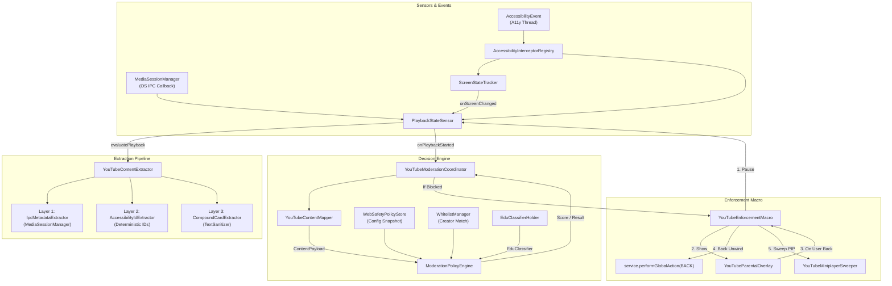
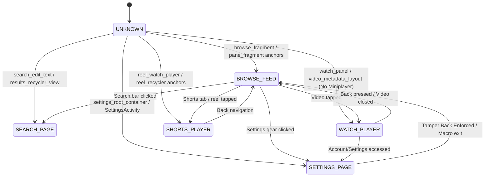
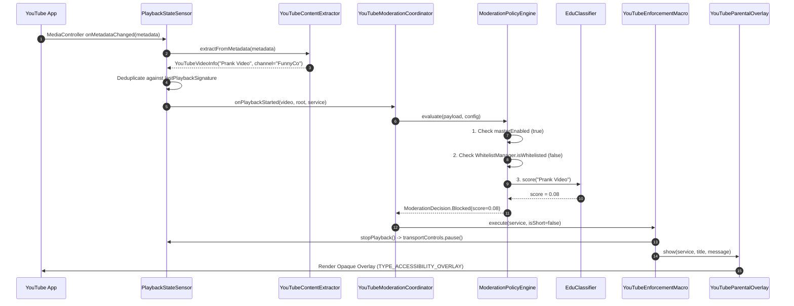
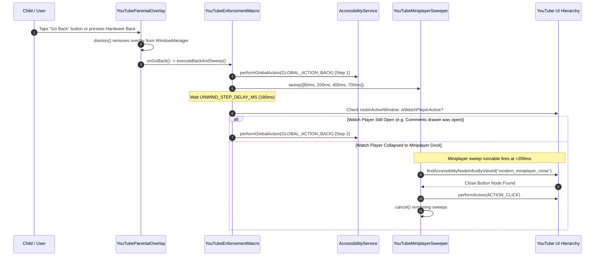

# YouTube Module Audit
**Subsystem**: `:feature:websafety` / YouTube Moderation Engine  
**Host Application**: Guardian Child (`com.guardian.child`)  
**Target Platform**: Android 8.0+ (API 26–37)
**Process Topology**: Dual-Process (`com.guardian.child` [Default UI] & `:protection` [Accessibility / Supervision])  
**Target Package**: `com.google.android.youtube`

---

## 1. Coverage Checklist

| Subsystem / Area | Inspected Files / Components |
|---|---|
| **Module Wiring & Registrations** | `settings.gradle.kts`, `app/build.gradle.kts`, `feature/websafety/build.gradle.kts`, `app/.../AndroidManifest.xml`, `feature/onboarding/.../AndroidManifest.xml` |
| **Application & Service Init** | `GuardianApplication.kt`, `GuardianPermissionServices.kt`, `WebSafetyInitializer.kt`, `AccessibilityEventInterceptor.kt` |
| **Sensor & Event Layer** | `ScreenStateTracker.kt`, `PlaybackStateSensor.kt`, `ScreenStateClassifier.kt`, `accessibility_service_config.xml` |
| **Extraction Engine** | `YouTubeContentExtractor.kt`, `IpcMetadataExtractor.kt`, `AccessibilityIdExtractor.kt`, `CompoundCardExtractor.kt`, `TextSanitizer.kt`, `YouTubeVideoInfo.kt` |
| **Intelligence & Decision Core** | `EduClassifier.kt`, `EduClassifierHolder.kt`, `ModerationPolicyEngine.kt`, `ModerationDecision.kt`, `WhitelistManager.kt`, `YouTubeContentMapper.kt` |
| **Policy & Configuration** | `WebSafetyConfigState.kt`, `WebSafetyPolicyDto.kt`, `WebSafetyPolicyStore.kt` |
| **Enforcement & Sweeping** | `YouTubeModerationCoordinator.kt`, `YouTubeEnforcementMacro.kt`, `YouTubeParentalOverlay.kt`, `YouTubeMiniplayerSweeper.kt` |
| **Hardening & Onboarding** | `YouTubeHardeningMacro.kt`, `RequiredPermissionsScreen.kt`, `OnlineSafetyScreen.kt` |
| **Remote Sync & FCM Routing** | `ParentalFcmService.kt`, `PushNotificationDispatcher.kt`, `NotificationListenerResolver.kt` |

---

## 2. Functional Roadmap and Data Flow

### 2.1. Flow A: YouTube Content Moderation Lifecycle

```
[A] Detect Screen / State Transition
           │
           ▼
[B] Extract Metadata (IPC -> A11y ID -> Compound)
           │
           ▼
[C] Policy Evaluation (Killswitch -> Whitelist -> ML Classifier)
           │
     ┌─────┴──────────────┐
     ▼                    ▼
[D] ALLOWED             [E] BLOCKED
(Playback continues)      │
                          ├─► 1. Pause Media Session (0ms)
                          ├─► 2. Render Fullscreen Touch-Shield Overlay
                          ├─► 3. Wait for "Go Back" / Hardware Back
                          ├─► 4. Step-Limited Unwind (Back navigation x 1..3)
                          └─► 5. Delayed Miniplayer Sweeps (80, 200, 400, 700ms)
```

---

#### [A] Screen State Transition (Refer to **Diagram 2 — YouTube Screen State Machine** for details)

1. 4 distinct Android events are registered in `accessibility_service_config.xml`.
    - `TYPE_WINDOW_STATE_CHANGED`: Triggers when entire screen changes. Mostly useful. Problem: Does not trigger when an educational video is playing and user clicks on another non educational video. Currently redundant.
    - `TYPE_WINDOW_CONTENT_CHANGED`: **Current reliable method for detecting screen state changes.** Triggers on any content changed. Fires several times per second when settling. **Throttled `( >=250ms )`** for performance.
    - `TYPE_VIEW_CLICKED`: Triggers on click events. Used to detect playback state clicks like `PAUSE`, `NEXT_VIDEO`, `PREVIOUS_VIDEO` etc.
    - `TYPE_VIEW_SCROLLED`: Triggers on scroll events. Only utility is detecting shorts scrolling. Currently obsolete because all shorts are blocked.
2. Using the triggers we identify 6 distinct states using **a11y anchors** and `ScreenStateClassifier.classify()`: 
    - `BROWSE_FEED`, `WATCH_PLAYER`, `SHORTS_PLAYER`, `SETTINGS_PAGE`, `SEARCH_PAGE`, `UNKNOWN`.
3. `PlaybackStateSensor` detects entering `WATCH_PLAYER`. Content evaluation occurs here.

> [!IMPORTANT]
> Deterministic Resource-ID Selectors listed in  `ScreenStateClassifier.kt` - `SHORTS_ANCHORS`, `WATCH_ANCHORS`, `SEARCH_ANCHORS`, `BROWSE_ANCHORS`, `SETTINGS_ANCHORS`.
>
> `SHORTS_PLAYER` and `SETTINGS_PAGE` triggers their respective blockers.
>
> **Fast path heuristics** exist for Shorts, Miniplayer, and Watch Player, early return if successful.

#### [B] Video Content Extraction

Uses 3 distinct tiers to extract data in the following structure - `YouTubeVideoInfo(title, description, channel, isShort=false)`. When data extraction succeeds at any stage the next stage is not used. **Currently Tier 1 - IPC Extraction succeeds everytime.** Therefore `null` is passed to `root` in `extractor()`. This disables Tier 2 and Tier 3 fallbacks ever triggering.
1. **Tier 1 (IPC)**: Checks cached YouTube `MediaController` metadata from `MediaSessionManager`. `description` always returns empty and `channel` takes a few seconds to load. It is not able to resolve shorts data.
2. **Tier 2 (Accessibility IDs)**: Fallback - Searches **a11y anchors/regex parsing** like `SUBSCRIBERS_REGEX` to resolve data. Pretty reliable but takes time.
3. **Tier 3 (Compound Card)**: Fallback - Crawls text nodes via `TextSanitizer.parseCardText()`. Uses an **Unbounded DFS** algorithm that may cause performance issues.

> [!IMPORTANT]
> The node tree scan depth is currently set to 35 to allow maximum coverage of content. Reducing this will improve performance but may lose necessary data.
>
> IPC extractor uses an Android callback hook `PlaybackStateSensor.sessionCallback.onMetadataChanged()` to trigger updates automatically every time MediaSessionManager refreshes its metadata. Therefore channel name loads after a few seconds.

#### [C] Content Evaluation (Refer to **Diagram 3 — Playback Detection & Moderation Sequence**.)

IPC title resolution is very fast compared to channel resolution. Therefore we currently do not wait for channel to resolve and evaluate solely on the video title and an empty description "". This uses less data for evaluation but achieves much higher speed.
1. Trigger Conditions:
    - **UI Pull:** User taps or scrolls caught by `ScreenStateTracker` triggers `PlaybackStateSensor.evaluatePlayback()`.
    - **OS Push:** `MediaMetadata` updates via Android OS caught by callback hook.
2. `ModerationPolicyEngine.evaluate()`:
    - Master killswitch check (`config.masterEnabled`).
    - Channel whitelist bypass (`WhitelistManager.isWhitelisted()`).
    - Shorts policy check (`BLOCK_ALL`, `ALLOW_ALL`, `SMART_FILTER`). Currently set to `BLOCK_ALL`.
    - ML inference via `EduClassifier.score()` gives a score to the content (0.0 to 1.0). This is checked against `config.mlThreshold` - currently set to **0.5**.

> [!IMPORTANT]
> Two different videos with the same title will not be evaluated.
> The function uses a **`video.signature`** (`title.trim().lowercase()`) to prevent same video from being evaluated twice.
> Originally the signature contained both `title` and `channel`. `channel` was later omitted for speed.

#### [E] Enforcement Macro (Refer to **Diagram 4 — Enforcement Unwind & Miniplayer Sweep Sequence**)

1. Cooldown check and deduplication: If invoked < 500ms ago || `isUnwinding` || `YouTubeParentalOverlay.isShowing`, drops duplicate.
2. Media Silencing: Calls `PlaybackStateSensor.Default.stopPlayback()` to immediately pause video playback.
3. Overlay: calls `YouTubeParentalOverlay.show()`:
   - Adds full-screen opaque view via `WindowManager.LayoutParams.TYPE_ACCESSIBILITY_OVERLAY`.
   - Captures focus and overrides `dispatchKeyEvent()` to swallow `KEYCODE_BACK`.
4. User Dismissal: User taps "Go Back" button or hardware back key:
   - `YouTubeParentalOverlay.dismiss()` immediately removes view from `WindowManager`.
   - Invokes `executeBackAndSweep(service, isShort)`.
5. State-Driven Unwind:
   - Dispatches `service.performGlobalAction(GLOBAL_ACTION_BACK)`.
   - Checks `ScreenStateClassifier.isWatchPlayerActive()`: if player layout is still active, recurses `unwind(step + 1)` up to `MAX_UNWIND_STEPS = 3`.
   - Checks `rootInActiveWindow.packageName`: if exited YouTube, halts.
   - If `!isShort`, primes `YouTubeMiniplayerSweeper.sweep()`.
6. Miniplayer Sweep:
   * Schedules delayed execution at `[80ms, 200ms, 400ms, 700ms]`.
   * Performs `ACTION_CLICK` on target button and self-terminates by cancelling remaining sweeps.

> [!IMPORTANT]
> Uses a **state driven recursive unwind** logic. 
> This is necessary because of 2 situations - fullscreen and livestreams (they require 2 back actions to go to the home screen). 
> Recursion base case is set to `isPlayerActive` toggled off. 

### 2.2. Flow B: Shorts Reel Interception & Evaluation
> [!IMPORTANT]
> The SMART_FILTER mode functionality is currently broken owing to the IPC Metadata extractor blocking fallbacks. 

1. User taps Shorts tab or swipes vertically between Shorts.
2. Vertical swipe fires `AccessibilityEvent.TYPE_VIEW_SCROLLED`.
3. `PlaybackStateSensor.onAccessibilityEvent()` catches scroll while in `SHORTS_PLAYER` and invokes `evaluatePlayback()`.
4. If `WebSafetyPolicyStore.current().shortsPolicy == ShortsPolicy.BLOCK_ALL`:
   * `YouTubeModerationCoordinator` immediately aborts evaluation and triggers `YouTubeEnforcementMacro.execute(service, isShort=true)`.
5. Under `SMART_FILTER`:
   * Title and channel are extracted via `SHORTS_TITLE_IDS` (`reel_player_title_text`, `reel_title`) or Litho node crawler `extractShortsFromTree()` (matching `"Go to channel "`, `"Subscribe to "`, `"@"`).
   * Passed to `ModerationPolicyEngine` with `isShort=true`.
6. Under `ALLOW_ALL`:
   * Instantly returns `ModerationDecision.Allowed(reason="Shorts allowed by parent policy", isWhitelisted=true)` without ML inference.

### 2.3. Flow C: Settings Tamper Protection
1. Child attempts to open YouTube Settings to revert restricted mode or feed settings.
2. `ScreenStateTracker` classifies `SETTINGS_PAGE` from anchors (`settings_root_container`, `settings_fragment`, `action_bar_title`).
3. `YouTubeModerationCoordinator.onScreenChanged()` evaluates:
   - Is `to == SETTINGS_PAGE`?
   - Is `config.blockSettings == true`?
   - Is `isMacroRunning == false`?
4. If all conditions are met:
   - Immediately dispatches `service.performGlobalAction(GLOBAL_ACTION_BACK)`.
   - Displays toast: `"YouTube Settings are locked by parental control"`.

### 2.4. Flow D: Settings Hardening Automation (Onboarding Macro)
> [!IMPORTANT]
> This macro is part of the onboarding process and not the YouTube evaluation process. Its task is to **Open YouTube and toggle certain settings**. It works by automatically launching the YouTube app, reading the screen, scrolling if required, and going to options 1-by-1 to toggle them. This flow may be flagged as malicious since it runs a script on a third-party app. This flow may also break easily on certain devices/layouts.

1. Onboarding UI (`RequiredPermissionsScreen`) issues broadcast `RUN_YOUTUBE_HARDENING_MACRO`.
2. `YouTubeHardeningMacro.execute()` acquires `_isRunning` lock and sets `YouTubeModerationCoordinator.isMacroRunning = true`. This prevents the Settings Tamper Protection from locking the macro when settings page is opened.
3. Attaches opaque touch-shield overlay to block user touches.
4. Executes linear sequence with 30-second timeout:
   - Step 1: Launches YouTube app.
   - Step 2: Navigates to Settings (clicks gear icon or "You" tab in bottom navigation).
   - Step 3: Sets "Playback in feeds" to OFF (handles tablet master-detail vs phone single-pane layout).
   - Step 4: Sets Autoplay to OFF (**scrolls down if needed on phone**).
   - Step 5: Dispatches launch intent to return to Guardian Child.
5. In `finally` block: dismisses touch shield, resets `isMacroRunning = false`, clears `_isRunning`.
6. Broadcasts `YOUTUBE_HARDENING_COMPLETE` to update onboarding UI.

---

## 3. Internal Implementation Reference

### 3.1 Additional Notes
- **Player UI Noise Filtering:** `TextSanitizer.kt` uses `NOISE_STRINGS`, `NOISE_PREFIXES`, `PROGRESS_REGEX`, `AD_REGEX` - 42 static noise strings, 20 noise prefixes to prevent false extractions.
- **Enforcement Cooldown:** `YouTubeEnforcementMacro.kt` has `COOLDOWN_MS = 500L` which drops enforcement triggers occurring within 500ms of a previous execution via `SystemClock.elapsedRealtime()`.
- **Async Asset Pre-Warming:** `EduClassifierHolder.kt` - `initAsync()`, `scope = CoroutineScope(SupervisorJob() + Dispatchers.IO)` Offloads 2.5MB JSON read and HashMap token allocation to background I/O dispatcher.
- **Macro Watchdog Timeout:** `YouTubeModerationCoordinator.kt` has `MACRO_TIMEOUT_MS = 35_000L` - custom getter on `@Volatile var isMacroRunning` automatically expires `true` back to `false` after 35 seconds to prevent permanent lockouts.
- **Touch Shield Accessibility Overlay:** `YouTubeParentalOverlay.kt`, `YouTubeHardeningMacro.kt` uses `TYPE_ACCESSIBILITY_OVERLAY`, `FLAG_LAYOUT_IN_SCREEN`, `PixelFormat.OPAQUE`. This intercepts key events (`KEYCODE_BACK`) and absorbs all touch input.

---

### 3.2 Design Rationale and Questions

#### 1. Why does tree traversal reach a configured depth of 35?
* **Evidence**: `ScreenStateClassifier.kt:162`, `YouTubeHardeningMacro.kt:67`.
* **Rationale**: YouTube's UI hierarchy is built on Google's Litho component framework, nesting views inside deep container hierarchies (`CoordinatorLayout` -> `ViewPager` -> `RecyclerView` -> `ComponentHost`). As documented in telemetry notes (`ScreenStateClassifier.kt:12`), YouTube Shorts reel anchors regularly reside between hierarchy depths 19 and 26. Standard Android hierarchy traversal limits (typically 10–15) fail to reach these leaf anchors.

#### 2. Why does miniplayer sweeping use 4 staggered delays (`listOf(80L, 200L, 400L, 700L)`)?
* **Evidence**: `YouTubeMiniplayerSweeper.kt:21`.
* **Rationale**: When back navigation collapses a video, YouTube's miniplayer dock animation duration varies widely based on device GPU performance, display refresh rates (60Hz vs 120Hz), and system load. The close button (`modern_miniplayer_close`) is not added or clickable until the collapse animation reaches its final frames. Staggered sweeps ensure the button is clicked at the earliest possible millisecond it appears, self-cancelling immediately to avoid extraneous tree scans.

---

### 3.3 Logical Concerns

* **DOM Fallback Bypassed on Missing MediaSession**: In `PlaybackStateSensor.kt:166` (`feature/websafety/.../sensors/`), `evaluatePlayback()` calls `extractor(null, currentState, context)`. Passing `null` as `root` causes `YouTubeContentExtractor.kt` (lines 29–40) to skip Layer 2 and Layer 3 accessibility node inspection entirely when `currentController` metadata is null.
* **Shorts Flag Overwrite Race Condition**: In `IpcMetadataExtractor.kt:64` (`feature/websafety/.../extractor/`), `extractFromMetadata()` hardcodes `isShort = false`. In `PlaybackStateSensor.kt:65`, `onMetadataChanged()` overrides `isShort = true` only if `stateProvider() == YouTubeScreenState.SHORTS_PLAYER`. If `ScreenStateTracker` has not yet transitioned to `SHORTS_PLAYER` when the metadata event arrives, the Short is processed as `isShort = false`.
* **Title-Only Signature Collision**: In `YouTubeVideoInfo.kt` (lines 9–10), `signature` is defined strictly as `title.trim().lowercase()`. In `PlaybackStateSensor.kt:175`, `dispatchPlayback()` drops events if `video.signature == lastPlaybackSignature`, silently suppressing evaluation when switching between different videos or Shorts sharing the same title.
* **Sweeper Indiscriminate Handler Clearing**: In `YouTubeMiniplayerSweeper.kt:57`, `cancel()` executes `handler?.removeCallbacksAndMessages(null)`, clearing all callbacks and messages across the entire main looper handler rather than solely miniplayer sweep tasks.
* **Synchronous Disk Commit on Main Looper**: In `YouTubeHardeningMacro.kt:89`, `markHardened()` calls `commit()` instead of `apply()`, forcing a synchronous disk write on the calling thread.
* **Dynamic Broadcast Receiver Leak**: In `YouTubeModerationCoordinator.kt:80`, `YouTubeHardeningMacro.registerTestReceiver(service)` registers `ACTION_RUN_MACRO` inside `addServiceConnectedCallback`. It is never unregistered on service disconnect or application termination.
* **Unrecycled Node Traversal in Fallback**: In `ScreenStateTracker.kt` (lines 103–109), `findRoot(node)` traverses `node.parent` in a `while` loop without recycling intermediate `AccessibilityNodeInfo` objects.
* **Premature UI Unwind Animation Assumption**: In `YouTubeEnforcementMacro.kt` (lines 122–148), `unwind()` relies on a fixed 180ms delay (`UNWIND_STEP_DELAY_MS`) to check `isWatchPlayerActive`. If YouTube's collapse animation exceeds 180ms, the condition remains true and fires up to 3 rapid back presses, potentially exiting YouTube to the device home screen.
* **Dead Remote Update Path**: In `WebSafetyPolicyStore.kt` (lines 43–67), `updateFromRemote()` is not called by any component in `:app` or `:feature:websafety`.
* **Unimplemented Search Filtering**: In `WebSafetyConfigState.kt:13`, `filterSearch` is declared, but native YouTube search queries and results are never intercepted or evaluated in `YouTubeModerationCoordinator.kt`.

---

## 4. Performance Audit

### 4.1 Exhaustive Bottleneck Inventory

| ID | Component & File | Execution Context | Trigger / Frequency | Cost Driver & Likely Impact | Evidence Level | Estimated Complexity |
|---|---|---|---|---|---|---|
| **PERF-01** | `EduClassifierHolder.kt:30-45`<br/>`websafety/.../core/`<br/>`get()` | Main (A11y) Thread | First playback evaluation if async pre-warming has not settled | **Synchronous 2.51MB JSON parse** via `org.json.JSONObject`. Allocates ~50,000 token objects and locks main thread looper for **800ms–2,000ms**, causing immediate UI jank or ANR. | **Confirmed** | O(N) where N ≈ 40,000 tokens |
| **PERF-02** | `EduClassifier.kt:37-56`<br/>`websafety/.../core/`<br/>`analyze()` & `score()` | Main (A11y) Thread | Every video / Short evaluation in `evaluateDecision()` | **Combinatorial string allocations**: computes unigrams, bigrams, and character n-grams (n in 2..5). Generates hundreds to thousands of intermediate String objects per title and map lookups into 40,000-entry table on the main looper. | **Confirmed** | O(L * K) where L = len, K = n-gram range |
| **PERF-03** | `ScreenStateClassifier.kt:166-182`<br/>`websafety/.../state/`<br/>`collectIds()` | Main (A11y) Thread | Every `TYPE_WINDOW_STATE_CHANGED`, `TYPE_VIEW_CLICKED`, and throttled `TYPE_WINDOW_CONTENT_CHANGED` (up to 4 Hz) | **Deep recursive DFS down to depth 35** over full view tree. Generates dozens of synchronous IPC binder transactions to `system_server` via `node.getChild(i)` on every state probe. | **Confirmed** | O(V + E) up to depth 35 (V ≈ 200–600 nodes) |
| **PERF-04** | `AccessibilityIdExtractor.kt:119-166`<br/>`websafety/.../extractor/`<br/>`findWatchChannel()`, `extractShorts()` | Main (A11y) Thread | Watch or Shorts extraction when deterministic view IDs are absent | **Unbounded recursive tree DFS** with regex evaluations (`SUBSCRIBE_TO_REGEX`, `SUBSCRIBERS_REGEX`) across every node in the window hierarchy directly on the UI thread. | **Confirmed** | O(V * R) where R = regex cost |
| **PERF-05** | `YouTubeHardeningMacro.kt:521-554`<br/>`websafety/.../coordinator/`<br/>`waitForNode()`, `findNodeScoped()` | Main Coroutine (`Dispatchers.Main`) | Every 200ms (`NODE_POLL_INTERVAL_MS`) during onboarding setup | **High-frequency polling DFS down to depth 35** every 200ms while waiting for UI controls (gear icon, tabs, switches), generating heavy IPC load during setup. | **Confirmed** | O(V) every 200ms for up to 30s |
| **PERF-06** | `YouTubeMiniplayerSweeper.kt:64-105`<br/>`websafety/.../coordinator/`<br/>`dismissMiniplayer()` | Main (Looper) Thread | Scheduled 4 times per blocked video: +80ms, +200ms, +400ms, +700ms | **Repeated IPC lookups**: 3 view ID searches followed by 3 text searches (`findAccessibilityNodeInfosByText`) across the active window until miniplayer is dismissed or times out. | **Likely** | 6 IPC lookups * up to 4 passes |
| **PERF-07** | `accessibility_service_config.xml:5`<br/>`onboarding/.../res/xml/`<br/>`flagIncludeNotImportantViews` | Android OS / Binder | Continuously for all accessibility events | **Massive tree bloating**: forcing Android to expose un-layouted, invisible, and structural wrapper views multiplies total node count by 2x–4x, exacerbating costs in PERF-03, PERF-04, and PERF-05. | **Confirmed** | Framework configuration |
| **PERF-08** | `WebSafetyInitializer.kt:28-51`<br/>`websafety/.../WebSafetyInitializer.kt`<br/>`initialize()` | Main (Looper) Thread | Process startup and repeated on every `onServiceConnected()` | **Unconditional re-execution**: store init, sensor registration, and pre-warming checks executed every time the accessibility service connects, adding unnecessary startup latency. | **Confirmed** | O(1) redundant main looper tasks |
| **PERF-09** | `CompoundCardExtractor.kt:34-51`<br/>`websafety/.../extractor/`<br/>`findBestCandidate()` | Main (A11y) Thread | Layer 3 fallback when Layers 1 & 2 yield no title | **Unbounded recursive DFS** inspecting `contentDescription` and `text` properties of every node until a string >= 5 characters is found. | **Likely** | O(V) unbounded |
| **PERF-10** | `ScreenStateTracker.kt:50-101`<br/>`websafety/.../state/`<br/>`onAccessibilityEvent()` | Main (A11y) Thread | Continuous accessibility event stream (60–120Hz during scrolling) | **Foreground package verification IPC**: calling `service.rootInActiveWindow?.packageName` inside event filter triggers synchronous binder IPC to `system_server` on transient events. | **Likely** | 1 IPC binder call per non-YouTube event |

---

## 5. Diagrams

### Diagram 1 — End-to-End Data Flow



### Diagram 2 — YouTube Screen State Machine



### Diagram 3 — Playback Detection & Moderation Sequence



### Diagram 4 — Enforcement Unwind & Miniplayer Sweep Sequence


